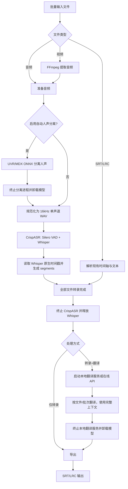

# VoiceTranslator V2 — 重新设计实施计划书

## 当前更新：前端显示检查与修复（2026-10-23）

- 目标：自行复现并修复首页、设置页在深浅主题、900×640 至默认窗口和 80%–200% 字体比例下的显示问题；保留文件导入、任务模式、设置保存和处理管线行为。实际问题及根因以渲染/布局证据确认，不进行无关视觉重设计。
- 基线与交付：初始工作区干净，`main` / `test` 均为 `f16ec5b`，在现有 `test` 实施；主 agent 负责本任务集成和本地主线交付。执行中发现另一会话已同步旧候选并准备 Tools 安装，协作调整为共享目录、各自固定候选与独立输出；其计划记录保持原样且不夹入本任务提交。本次交付前端源码，不接管该会话的推送或安装工作。
- 资源：复用 `app/views/`、`app/ui_scale.py`、现有 pytest、`build/test-remove-qwen-asr/scripts/ui_smoke.py` 的隔离配置/字体加载方式及 README 结构索引。界面证据和测试输出统一放 `build/test-ui-display/`，不读取或改写实际用户配置，不启动模型推理。
- 分工：同批 `home_display` 独占首页与首页回归，`settings_display` 独占设置页及设置显示回归；先调查并回报根因，主 agent 完成基线截图后通知实施。主 agent 独占字体比例、主窗口、集成渲染脚本、计划和文档；公共字体/主题接口由主 agent 协调，子任务不操作 Git 或安装。
- 验收：真实 Qt 控件渲染与尺寸检查覆盖主题、缩放、最小窗口、滚动可达及主题即时切换；为已证实的行为故障添加必要回归，运行完整 pytest 与差异检查。区分 offscreen、Windows 平台渲染和打包/安装验证，未覆盖项如实记录。
- 根因与实现：原生 Qt 标签/字段/表格未跟随 Fluent 深色主题，且 QSS 容器阻断实时颜色和字体继承；主 agent 统一使用 Fusion/主题调色板，跨样式容器同步颜色，分别缩放 Qt 点字体与 Fluent 像素字体并保存基准，避免重复累乘。`home_display` 为首页增加透明滚动容器、原生下拉菜单和表格自适应行/列；`settings_display` 处理长表单换行、只读可复制模型规格及 API 模型名撑宽页面的问题。
- 验证：最终 `python -X utf8 -m pytest -p no:cacheprovider --basetemp build/test-ui-display/verified --junitxml build/test-ui-display/verified.xml`：**91 passed in 9.92s**。首页 8 项覆盖缩放、下拉鼠标选择、拖放穿过滚动视口、重复导入和删除，设置/背景定向 13 项通过。真实设置保存循环覆盖浅色→深色→浅色与 80%/125%/200%，27 个设置页检查无水平溢出且保存可达；同窗口字体反复切换、主题反复切换及最终绘制像素均通过。主 agent 复核全部实现，`settings_display` 独立检查公共字体/主题未发现阻塞问题。
- 渲染与边界：保留 `build/test-ui-display/baseline-opaque/` 修复前证据、`home/` 和 `settings/` 最小窗口最终证据、`default-size/` 默认窗口矩阵、`native/` 的 Windows QPA 启动与窗口截图。Mica 由 Windows DWM 合成，Qt 窗口截图不能证明完整系统背景；初次透明截图造成白底假象，已用官方不透明 fallback 复核，真正缺陷为深色底上的原生黑色标签/白色输入控件。未改用户配置、运行模型推理、构建或替换 EXE。
- 文档与整理：README 补充滚动、长模型名及字体入口；现有结构说明可复用，无新增依赖或领域 skill。可重跑渲染脚本位于 `build/test-ui-display/scripts/render_ui.py`，失败与最终测试报告分别保留，清理本任务已被最终证据替代的截图和隔离基线源码。
- 状态：源码修复、回归与独立复核完成。交付采用本地 `test` 候选与 `main` 快进；另一会话仍在更新共享计划，因此保持当前 `test` checkout、仅暂存本任务计划段。提交、两分支一致性及未提交记录保留情况存于 `build/test-ui-display/delivery.json`。远端只读核实两分支仍为 `f16ec5b`，本次不推送或安装。

## 当前更新：移除 Qwen ASR 支持（2026-10-23）

- 目标：应用只使用 CrispASR + Whisper 转录；移除 Qwen3-ASR、Forced Aligner、独立语言检测模型的运行入口、界面、配置和使用说明。保留 Whisper 自动/指定源语言、VAD、字幕处理、进程卸载及 Qwen 文本翻译。
- 兼容：读取旧配置时保留独立 Whisper 设置及其他用户设置，清除已停用的 ASR 键；旧 Qwen 共享模型和参数不得迁入 Whisper。模型文件、个人配置与已有发布包不做批量删除。
- 模式与基线：个人模式，主 agent 负责集成、Git 和交付；初始工作区干净，基线 `8f27064`，在 `test` 分支实施。既有远端为 `Panda-Panta/VoiceTranslator`，已核对拥有写入权限、`main` 无保护或必需检查且仍与基线一致；本地按项目约定直接合入，公开推送因自动审批要求明确授权而暂缓。未确认本次安装目标，本次交付源码，不发布版本或替换现有安装。
- 资源：复用 `python -m pytest`、现有 `tests/`、`tools/build_portable.ps1` 和 `tools/check_whisper_runtime.py`；后者会读取真实用户配置，运行检查改用隔离配置。沿用本计划和 `README_VOICE_TRANSLATOR.md` 的结构说明，无需新增文档体系或依赖。
- 接口：`AppConfig` 保留 `asr_whisper_model_path`、`asr_whisper_extra_args` 及通用转录设置，删除后端选择、Qwen 专属字段与多后端选择方法；`CrispASREngine` 固定 Whisper，不接受后端、Aligner 或 LID 参数。
- 并行批次：`asr_core` 独占 `app/core/crispasr_engine.py`、`app/core/pipeline.py`、`app/core/language_detection.py` 及对应引擎/管线/语言/LID 测试；`asr_ui` 独占 `app/views/settings_interfaces.py`、`app/views/home_interface.py` 及设置/首页测试；主 agent 独占 `app/config.py`、`tests/test_config.py`、便携包模板、计划和使用文档。子任务不操作 Git 或安装。
- 验收：旧配置迁移、Whisper 命令与自动/指定语言、设置保存、VAD、取消/失败卸载和翻译顺序回归；运行完整 pytest、差异与残留引用检查，按本地资源条件补真实 Whisper/界面冒烟。测试输出放 `build/test-remove-qwen-asr/`；构建/模拟/实际模型运行证据分别记录。
- 实施结果：`asr_core` 与 `asr_ui` 同批并行完成核心和界面移除；主 agent 完成迁移、安装/便携包模板及文档。Qwen 相关源码字符串仅用于旧键清理、禁止已移除参数的检查和回归样本；本地翻译支持与历史来源说明保留。
- 验证结果：Windows / Python 3.11 / Qt offscreen，基线 54 项通过；配置 13 项、UI 6 项、核心 36 项定向测试通过。最终命令 `python -X utf8 -m pytest -p no:cacheprovider --basetemp build/test-remove-qwen-asr/integration --junitxml build/test-remove-qwen-asr/integration.xml`：**76 passed in 8.75s**。两份 PowerShell 脚本 AST 语法检查、`git diff --check` 及全项目残留引用核对通过。
- 界面与审查：使用隔离的旧 Qwen 配置完成 `MainWindow` 启动、Whisper 设置渲染、关闭保存及翻译设置保留冒烟；截图位于 `build/test-remove-qwen-asr/whisper-settings.png`。`asr_ui` 独立审查未参与编写的配置/核心/工具并复核历史迁移契约，未发现阻塞缺陷。
- 证据边界：当前源码目录缺少 CrispASR 可执行文件与 Whisper 权重，未实跑模型推理、GPU 或真实进程取消；未构建或安装新版 EXE。测试中的识别/翻译使用模拟引擎。主窗口证据为 offscreen 渲染，首次缺少字体，显式加载系统字体后重新检查通过，不代表可见窗口环境实测。
- 执行修正：首次 pytest 的 `--basetemp` 父目录不存在导致夹具创建失败，创建父目录后基线通过；新增字幕测试的枚举名曾误写为 `ORIGINAL`，改为现有 `SOURCE_ONLY` 后通过。此类运行准备问题不记为产品缺陷。
- 文档与整理：维护原有计划、README、模型指南及来源说明；工具和结构入口已核对。保留最终测试报告、界面证据和可重跑的冒烟脚本。临时夹具清理先因检测到符号链接停止，核实 80 个链接均为 pytest 生成且目标在本次夹具目录内后，仅删除链接本身，再清理 7 个已完成测试目标；用户模型、实际配置和旧发布包未改动。现有开发流程已能覆盖本次操作，无新增领域 skill。
- Git 结果：实现候选 `1516dd91240c604a3679a7105e9bac65ffa1a724` 已提交到本地 `test` 并快进合入本地 `main`，两分支源码树一致；本段为随后的纯文档交付记录，不改变已测程序。推送在执行前被自动审批拒绝，理由是公开仓库未获针对本次源码内容的明确发布授权，未改用其他通道绕过。远端最后只读核实的 `main` 为 `8f27064d9a194a4867dd41b1db436031a5081873`，尚无远端 `test`。
- 状态：本地源码实现、回归、审查与主线合入完成；待用户明确允许向现有公开仓库推送后，仅补远端核对和普通同步。未构建、发布或安装新版本。

## 1. 项目定位

VoiceTranslator V2 是一款 Windows 优先、本地化优先的音视频转录与字幕翻译工具，面向动画、影视、访谈、课程和带背景音乐的音频。

核心目标：

1. 默认使用 Whisper large-v2 Q8 生成高质量文本，可选择 large-v3 或 large-v3-turbo。
2. 使用 Silero VAD 与 Whisper 原生时间戳生成可靠的逐句时间轴。
3. 对带伴奏音频提供可选的 UVR/MDX 自动人声分离。
4. 支持本地 Hy-MT/Qwen/Gemma 等 GGUF 翻译模型及在线 OpenAI 兼容 API。
5. 严格串行执行重型模型，阶段完成后立即卸载，避免显存争抢。
6. 支持批量文件、SRT/LRC、双语字幕及源目录输出。

非目标：

- 不在首个稳定版本中实现视频下载、视频压制、字幕总结和说话人分离。
- 不同时驻留 ASR、分离和本地翻译模型。
- 不把在线服务作为默认路径。

---

## 2. 已确认结论与架构调整

| 项目 | 原始方案 | V2 决策 | 原因 |
|:---|:---|:---|:---|
| ASR 运行时 | llama-server | CrispASR CLI/进程管理 | 当前 llama.cpp 转录接口只返回普通 JSON，不能稳定提供片段级时间轴 |
| ASR 模型 | Qwen3-ASR 主 GGUF + mmproj | 仅 Whisper，默认 large-v2 Q8 | 按当前需求移除 Qwen ASR 支持，保留 Whisper 原生时间戳 |
| 时间轴 | 假设 ASR API 返回 segments | Whisper 原生时间戳 + Silero VAD | 不需要额外加载 Forced Aligner，链路更简单、显存更低 |
| 背景音乐 | 直接送入 ASR | 可选 UVR/MDX ONNX 人声分离 | VAD 只能检测语音，不能去除与对白同时存在的音乐 |
| 本地翻译 | llama-server | 保留 llama-server | OpenAI 兼容聊天接口适合 Hy-MT2 等 GGUF 翻译模型 |
| 模型生命周期 | 任务后可能保持服务 | 每阶段完成立即终止进程 | 释放 RAM/显存，保证下一阶段有足够资源 |
| 批次顺序 | 可能边转录边翻译 | 全部转录完成后才允许翻译 | 保证完整上下文并避免 GPU 竞争 |
| 默认输出 | 自定义目录 | 默认与源文件相同，可改为自定义目录 | 符合桌面文件处理习惯 |

结论：V2 当前只以 CrispASR + Whisper 为正式 ASR；llama-server 只服务于本地文本翻译。

---

## 3. 总体处理管线



### 严格阶段顺序

1. 文件准备阶段。
2. 可选人声分离阶段。
3. 全批次转录与时间轴阶段。
4. ASR 完全卸载。
5. 全批次翻译阶段。
6. 翻译模型完全卸载。
7. 导出阶段。

任何阶段发生失败或取消时，都必须通过 `finally` 终止当前子进程并清理临时文件。

---

## 4. 音频预处理设计

### 4.1 普通音频

- 使用 FFmpeg 转换为 PCM 16-bit、16 kHz、单声道 WAV。
- 保留原始文件，不在源目录生成中间文件。
- 中间音频统一放入任务临时目录。

### 4.2 带背景音乐音频

自动人声分离为可选功能，默认关闭：

1. 视频先提取为 44.1 kHz 双声道 WAV，避免在分离前损失频谱信息。
2. 音频输入复制到临时目录。
3. 使用 UVR/MDX ONNX 模型分离人声与伴奏。
4. 根据模型类型选择输出：
   - 模型预测伴奏：使用残差人声轨。
   - 模型预测人声：直接使用模型输出轨。
5. 分离完成后终止独立进程，确保 ONNX 模型和 DirectML 显存释放。
6. 将人声轨规范化为 16 kHz 单声道 WAV，再交给 CrispASR。

必须在 UI 中明确显示“模型输出伴奏”或“模型输出人声”，不能仅依赖文件名判断。

### 4.3 VAD 的职责边界

VAD 只负责：

- 跳过无语音区间。
- 按停顿切分语音段。
- 降低长音频一次推理的长度。

VAD 不负责：

- 去除与对白同时出现的音乐。
- 去混响。
- 消除持续风声、电流声。

---

## 5. 转录与时间轴设计

### 5.1 CrispASR 命令

基准调用形式：

```text
crispasr.exe
  --backend whisper
  --model <ggml-large-v2-q8_0.bin>
  --language auto
  --output-srt
  --output-file <temp/output>
  --file <temp/input.wav>
  --vad
  --vad-model <ggml-silero-v6.2.0.bin>
  --vad-min-silence-duration-ms 500
  --vad-speech-pad-ms 150
```

### 5.2 模型职责

- Whisper：识别语言和文字，并原生生成片段时间戳。
- Silero VAD：寻找语音区间并将时间映射回原始音轨。
- 自动语言检测由所选 Whisper 模型完成，不需要附加 LID 或对齐模型。

### 5.3 长文件

- 默认依赖 CrispASR VAD 处理。
- 可选启用“大文件恢复分段”，例如每 20–30 分钟切分。
- 每个大分段独立生成 SRT。
- 合并时累加精确音频时长偏移并重新编号。
- 翻译必须等所有分段合并为完整原文后才开始。

### 5.4 批量模型复用

第一阶段以“每文件一个 CrispASR 子进程”为可靠实现，确保崩溃隔离和自动卸载。

性能优化阶段再验证以下方案：

- CrispASR server 模式是否能返回与 CLI 一致的 Whisper segment 时间戳。
- 单进程重复 `-f` 输入是否能稳定产生独立输出。

只有在时间轴结果与 CLI 一致时，才允许改为常驻整个转录阶段的服务模式。

---

## 6. 翻译设计

### 6.1 本地翻译

- llama-server 仅加载翻译 GGUF。
- 默认端口 8080。
- 支持 Hy-MT2、Qwen、Gemma 等模型。
- Hy-MT2 使用官方“只输出译文”提示格式，不使用通用 JSON system prompt。
- 多条字幕通过不可翻译分隔符批处理；分隔符丢失时退化为逐条重试。

### 6.2 在线翻译

- 支持 OpenAI、DeepSeek 和任意 OpenAI 兼容端点。
- 支持 `GET /v1/models` 刷新模型列表。
- API Key 仅写入用户配置目录，不写入项目。

### 6.3 上下文策略

- 转录全部完成后构建完整上下文。
- 实际翻译按 1–50 条字幕分批。
- 每批携带邻近上下文或压缩后的全文上下文，避免超出模型上下文窗口。
- 严格保持字幕编号、条目数量和时间轴不变。

---

## 7. 模型生命周期状态机

```text
IDLE
  → SEPARATING
  → UNLOAD_SEPARATOR
  → TRANSCRIBING
  → UNLOAD_ASR
  → TRANSLATING
  → UNLOAD_TRANSLATOR
  → EXPORTING
  → COMPLETED
```

异常路径：

```text
任意状态 → CANCELLING/FAILED → STOP_ACTIVE_PROCESS → CLEAN_TEMP → IDLE
```

必须满足：

- 同一时刻最多存在一个重型本地模型进程。
- 人声分离结束后才允许加载 ASR。
- ASR 全部结束并确认进程退出后才允许加载本地翻译模型。
- 关闭应用时终止所有子进程。
- 正常、失败、取消和超时都执行相同的清理逻辑。

---

## 8. UI 重新设计

### 8.1 首页

- 文件拖拽与批量选择。
- 文件名、类型、大小、当前状态和输出路径。
- 处理方式：仅转录 / 转录并翻译。
- 目标语言。
- 导出格式：SRT / LRC。
- 内容模式：双语 / 仅原文 / 仅译文。
- 进度、当前阶段、日志、取消按钮。

交互约束：

- 选择“仅转录”时禁用翻译相关控件，但不改变用户原有选择。
- SRT/LRC 输入自动跳过音频预处理和 ASR。
- 启用人声分离但未配置 ONNX 模型时，开始前直接提示。

### 8.2 全局设置

- FFmpeg 路径。
- CrispASR 路径。
- llama-server 路径。
- 默认输出位置：与源文件相同 / 自定义目录。
- 主题、语言、完成通知和自动打开目录。

### 8.3 转录设置

音频预处理：

- 自动人声分离开关。
- UVR/MDX ONNX 模型路径。
- 模型目标：伴奏 / 人声。

ASR：

- Whisper large-v2 / large-v3 / large-v3-turbo 等 `.bin` 模型。
- Silero VAD 本地模型。
- Backend：固定为 whisper。
- 识别语言：自动或指定。
- VAD 参数。
- Whisper 自定义参数；语言和模型等受控参数通过界面配置。

### 8.4 翻译设置

- 本地 / 在线引擎。
- 翻译模型路径与 GPU 参数。
- API 地址、密钥和模型列表。
- Temperature、批量大小、提示词。
- “完成后自动卸载”固定启用并作为只读说明展示。

---

## 9. 配置模型

新增或保留以下关键配置：

```text
ffmpeg_path
crispasr_path
llama_server_path
output_directory_mode = source | custom
output_directory
background_enabled
background_image_path
background_scale_mode = cover | contain | stretch | tile
background_opacity = 0..100

vocal_separation_enabled
vocal_separation_model_path
vocal_separation_model_target = instrumental | vocals

asr_whisper_model_path
asr_language
asr_vad_enabled
asr_vad_model_path
asr_vad_min_silence_ms
asr_device
asr_whisper_extra_args

translation_engine = local | online
translation_model_path
translation_gpu_layers
translation_context_size
translation_port
api_base_url
api_key
api_model
batch_size
temperature
translation_prompt
```

旧版本的 llama.cpp ASR 主模型/mmproj 配置不再读取；安装器会清理这些旧键。旧 Whisper 共享配置迁移到专属字段；Qwen ASR、后端选择、Aligner 和 LID 配置清除，其他设置保留。

---

## 10. 当前项目结构与维护入口

```text
VoiceTranslator/
├── main.py
├── app/
│   ├── config.py
│   ├── common/
│   ├── models/
│   ├── core/
│   │   ├── pipeline.py
│   │   ├── file_handler.py
│   │   ├── vocal_separator.py
│   │   ├── crispasr_engine.py
│   │   ├── translator.py
│   │   ├── llama_server_manager.py
│   │   └── subtitle_parser.py
│   └── views/
│       ├── main_window.py
│       ├── home_interface.py
│       └── settings_interfaces.py
├── resources/
├── tests/
└── tools/
```

结构、工具与产物职责见 [README_VOICE_TRANSLATOR.md 的维护入口](README_VOICE_TRANSLATOR.md#维护入口)。本次删除独立的 `app/core/language_detection.py` 及其 LID 测试；其他模块布局保持现状。当前 `translator.py` 与 `translator/` 并存的问题留在原有重构待办，本次不扩展处理。

---

## 11. 错误处理

| 场景 | 行为 |
|:---|:---|
| FFmpeg 不存在 | 开始前阻止任务并定位到全局设置 |
| 分离模型不存在 | 仅在启用自动分离时阻止任务 |
| 分离失败 | 清理临时输出，不启动 ASR |
| CrispASR/Whisper 模型不存在 | 阻止转录并指出缺失项 |
| ASR 生成空字幕 | 标记该文件失败，不进入翻译 |
| 本地翻译服务启动超时 | 终止进程并保留原文字幕 |
| 在线 API 失败 | 支持有限次数重试，最终保留原文和中间数据 |
| 用户取消 | 终止当前进程、释放模型、删除临时文件 |
| 输出重名 | 默认生成 `_1`、`_2` 后缀，不覆盖原文件 |

---

## 12. 测试与验收

### 12.1 自动测试

- 文件类型识别。
- FFmpeg 命令参数。
- 人声分离模型目标与输出轨选择。
- 人声分离结束后才启动 ASR。
- CrispASR 命令构造。
- VAD 与 Whisper 自动/指定源语言参数传递。
- SRT/LRC 解析、合并和六种导出组合。
- 全批转录完成后才调用 Translator。
- 成功、失败、取消时的模型卸载顺序。
- 配置迁移。
- “仅转录”不修改内容模式。
- 源目录与自定义目录输出。

### 12.2 实机测试矩阵

1. 纯对白 WAV。
2. 带轻微背景音乐的音频，不启用分离。
3. 音乐明显覆盖对白的音频，启用 UVR 分离。
4. 长视频与多段对白。
5. 日语动画对白。
6. SRT/LRC 直接翻译。
7. 批量混合输入。
8. 转录中取消、分离中取消、翻译中取消。
9. 低显存环境下确认三个模型不同时驻留。

### 12.3 验收标准

- 输出字幕具有逐句开始和结束时间，而不是整段单一时间轴。
- 带背景音乐样本启用分离后，识别错误率有可感知下降。
- 批次中最后一个文件转录完成前，翻译模型不得启动。
- 每个阶段结束后，对应进程消失且 GPU 显存释放。
- 取消任务后 10 秒内无残留子进程。
- 源文件和源目录不出现临时 WAV、分离轨或缓存 JSON。
- SRT/LRC 时间轴单调、无负数、无重复编号。

---

## 13. 开发阶段

### Phase 0：代码基线整理

- 清理同名模块重复实现。
- 保留上游许可证和必要资产。
- 固化现有 18 项测试。

### Phase 1：CrispASR 转录核心

- 新增 CrispASREngine。
- 接入 Whisper、Silero VAD 和原生时间戳。
- 将 CrispASR SRT 转换为统一 segment 数据。
- 移除正式管线对 llama.cpp ASR API 的依赖。

### Phase 2：音频预处理完善

- 完成分离后 16 kHz 单声道规范化。
- 增加 ONNX 模型目标说明和输出试听验证。
- 完善取消、超时和临时文件清理。

### Phase 3：严格串行批处理

- 全批次预处理。
- 全批次转录。
- ASR 卸载屏障。
- 全批次翻译。
- 翻译卸载屏障。

### Phase 4：UI 与配置迁移

- 全局路径重新分组。
- Whisper/CrispASR/VAD 设置。
- 旧 ASR 配置迁移提示。
- 首页阶段状态展示。

### Phase 5：质量与发布

- 完成自动测试和实机矩阵。
- 增加一键环境检查。
- 打包时包含必要运行库，不打包模型权重。
- 编写模型下载与选择指南。

---

## 14. 当前状态与下一步

当前代码已经具备：

- QFluentWidgets 基础 UI。
- 批量文件、SRT/LRC 和导出。
- Whisper + CrispASR 转录路径，默认 large-v2 Q8。
- Silero VAD、Whisper 原生 SRT 时间轴和自动语言检测。
- llama-server 本地翻译与在线翻译。
- 自动模型卸载。
- 可选 UVR/MDX 人声分离及 DirectML 环境。
- 源目录输出和仅转录 UI 修复。
- 一键 Whisper 运行时安装和检查脚本。
- 自动测试覆盖及本次运行结果见顶部当前更新记录。
- 历史阶段曾完成 RTX 3060 Laptop GPU 的 CUDA 转录、SRT 导出和进程卸载验证；这不替代本次候选的模型实测。

尚未完成的关键工作：

1. 使用真实日语动画/影视样本进行逐句时间轴与强背景音乐测试。
2. 准备并验证合适的 UVR/MDX ONNX 人声分离模型。
3. 根据真实素材结果增加字幕长度约束、重复抑制和低置信度重试。
4. 清理临时兼容阶段产生的重复模块结构。

建议下一实施目标：用用户的动画 PV 素材完成 Whisper Turbo、不开分离和开启分离三组端到端对比。
